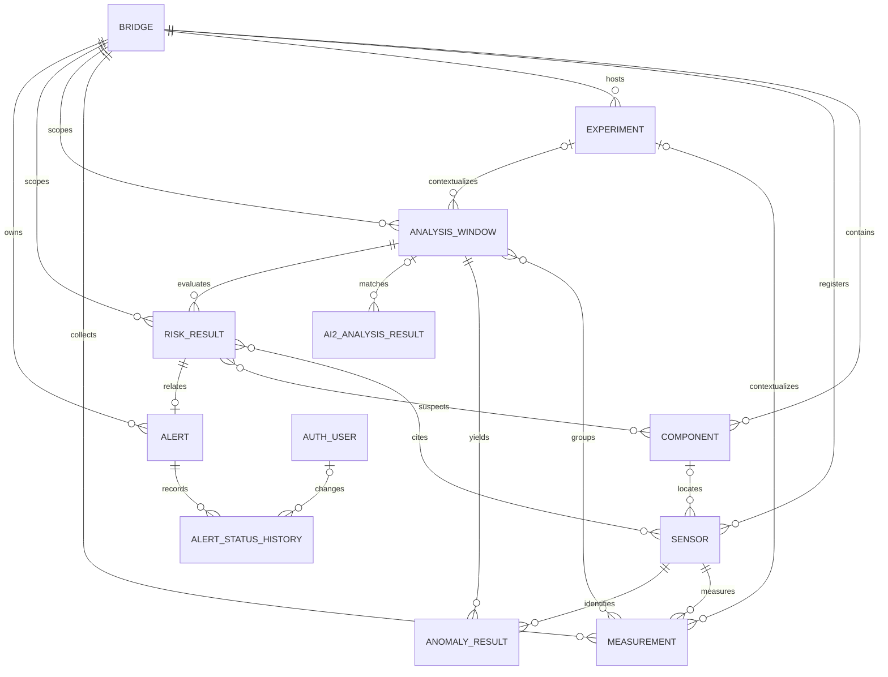
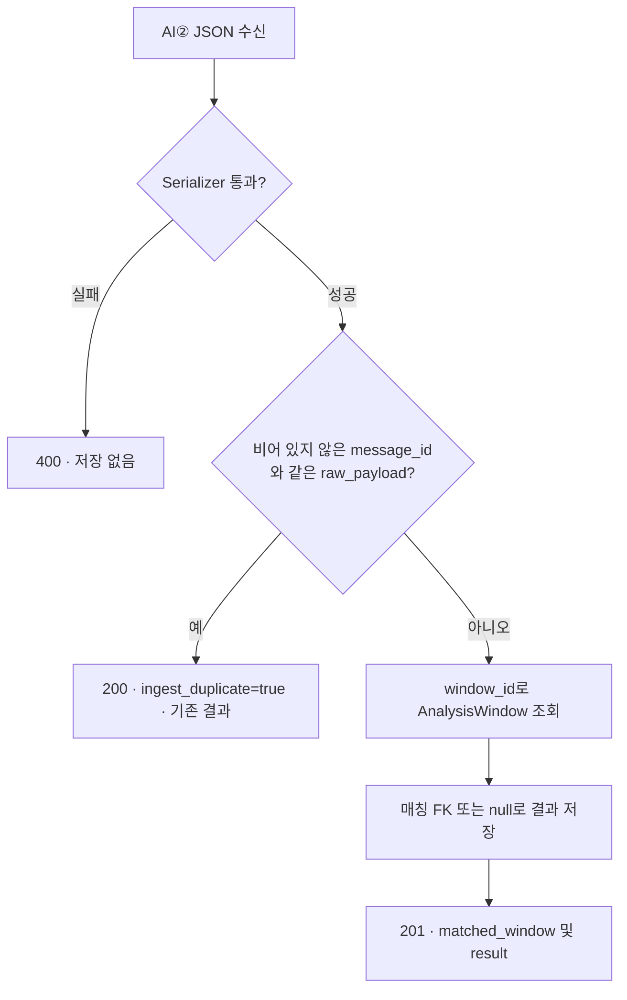

# INFRIUM 백엔드 개발 명세

이 문서는 [프로젝트 전체 개발 문서](INFRIUM.md)의 BE 구현을 상세히 설명한다. 확인 기준은 BE 작업 트리의 `a91bdc5` 구현이다. [이전 연동 준비 기록](../myapp/README.md)은 ACC 3축 저장과 AI② 읽기 API를 준비한 시점의 자료다. 현재 코드에는 AI② Ingest와 조회 라우터가 모두 등록되어 있으며, AI①·AI②로 요청을 보내는 자동 분석 클라이언트는 후속 범위다.

## 1. 처리 구조와 개발 환경

HTTP 요청은 `Infrium/urls.py`에서 `/api/v1/` 아래 `myapp/urls.py`로 전달된다. View는 인증·조회·처리 순서를 결정하고, Serializer는 입력과 출력 형식을 다룬다. Django ORM은 FK·인덱스·제약과 트랜잭션을 사용해 MySQL에 저장한다. FE는 등록·조회·알림용 API를, HW와 AI②는 각각 별도 수신 API를 사용하도록 설계됐다.

| 영역 | 구현 또는 사용 방식 |
| --- | --- |
| Django / DRF | `requirements.txt`에 Django `5.2.18`, DRF `3.18.3`이 기재되어 있다. 설정 헤더의 생성 버전과 구분한다. 설치 및 런타임 버전은 별도 확인이 필요하다. |
| MySQL / Django ORM | `django.db.backends.mysql` 및 `mysqlclient` 설정. 기본 연결 대상은 `127.0.0.1:3306/infrium_db`다. |
| 인증 | DRF TokenAuthentication 및 Django User |
| CORS / 환경 설정 | `django-cors-headers`, `python-dotenv` |
| 수동 검증 | Postman으로 요청과 응답을 검증할 수 있다. ngrok은 개발 중 원격 연결용으로 설정에 반영되어 있다. |
| 협업 | Git / GitHub. 확인된 브랜치와 제안 규칙은 마지막 절 참고. |

```text
BE/
├── manage.py
├── requirements.txt
├── .env.example
├── Infrium/
│   ├── settings.py        # 앱, MySQL, CORS, 인증
│   ├── urls.py            # admin 및 API 진입점
│   └── asgi.py / wsgi.py  # 서버 진입점
└── myapp/
    ├── models.py          # 교량부터 분석·알림·로그까지의 DB 모델
    ├── serializers.py     # CRUD, 인증, AI② 계약 검증
    ├── views.py           # 배치·필터·상태 변경·AI② 저장
    ├── urls.py            # DefaultRouter, 인증 라우트
    ├── migrations/        # 0001–0006 스키마 이력
    └── tests.py           # 현재 테스트 케이스 없음
```

개발 DB와 접속 사용자를 준비하고 `.env.example`을 `.env`로 복사해 실제 값을 채운 뒤 BE 디렉터리에서 실행한다.

```powershell
python -m pip install -r requirements.txt
python manage.py check
python manage.py makemigrations --check --dry-run
python manage.py migrate
python manage.py showmigrations myapp authtoken
python manage.py runserver
```

`0001`은 초기 모델, `0002`는 PK 필드 설정, `0003`은 ACC 3축 추가와 단일 계측값 필드 변경, `0004`는 분석 입력 JSON과 AI② 결과 모델, `0005`는 알림 읽음 필드, `0006`은 AI② 수신 계약에 대응하는 확장이다. 마이그레이션 파일의 존재와 특정 DB에 적용된 상태는 각각 확인한다.

## 2. DB 설계와 ERD

ORM 내부 FK와 API의 업무 식별자를 구분한다. 예를 들어 일반 CRUD의 `bridge`는 숫자 PK이고, 배치 요청의 `bridge_id`는 등록된 문자열이다. 센서와 부재 ID는 교량 안에서 유일하다. 계측 이벤트·실험·Window ID는 각각 자기 테이블 전체에서 유일하다.



`OperationLog`는 업무 테이블에 FK가 없는 독립 모델이다. Bridge와 대부분의 하위 모델 관계에는 `CASCADE`가 적용된다. Sensor의 Component, Measurement 및 AnalysisWindow의 Experiment, AI② 결과의 Window, History의 User는 삭제 시 `SET_NULL`로 레코드를 보존한다. Window와 Measurement, 위험 결과와 센서·부재의 다대다 관계는 ORM 중간 테이블로 관리된다.

### 2.1 Bridge · `bridges`

교량별 등록과 필터의 기준이다. `bridge_id`는 전역 고유 문자열(50자), `bridge_type`은 `STEEL_BOX / STEEL_TRUSS`다. `name`, `description`으로 교량의 표시 정보를 보관하고 `created_at`, `updated_at`은 ORM이 기록한다. AI② 계약의 `BOX / TRUSS`는 별도 표현이다.

### 2.2 Component · `components`

교량을 부재 단위로 나눠 센서 배치와 위험 결과의 의심 위치를 표현한다. `bridge`, `component_id`(50자), `name`, `description`을 가진다. `(bridge, component_id)`에 고유 제약과 인덱스가 있다.

### 2.3 Sensor · `sensors`

계측을 발생시키는 장치의 메타데이터를 등록한다. `bridge`와 선택적인 `component` FK, `sensor_id`, `sensor_type`, `location`, `zone_id`를 저장한다. 선택적인 실수 좌표 `model_x`, `model_y`, `model_z`를 3D 모델 위치 표시에 사용한다. `default_unit`은 배치 기본 단위, `is_active`는 수신 대상 여부이며 기본값은 참이다. `created_at/updated_at`도 보관한다. `(bridge, sensor_id)`는 고유하며, 교량·센서, 교량·부재, 센서 종류로 인덱싱한다.

### 2.4 Experiment · `experiments`

동일 교량에서 조건을 달리한 계측을 구분한다. `experiment_id`는 전역 고유 문자열(100자)이며 `bridge`와 연결된다. `stage`는 `NORMAL / ABNORMAL`, `condition_code`는 `NORMAL / D1 / D2 / D3`이고 기본값은 `NORMAL`이다. 자유 입력 `damage_state`, 하중 `load_n`, 위치 `load_position`(`LEFT / CENTER / RIGHT`), 출처 `load_source`(`LOAD_CELL / KNOWN_MASS`), 반복 번호 `repeat_no`, 충격 조건 `impact_condition`, 실험 기간 `started_at / ended_at`, `description`, `created_at`을 보관한다.

### 2.5 Measurement · `measurements`

| 필드 | 형식과 목적 |
| --- | --- |
| `event_id` | 문자열 최대 100자. 전역 고유 계측 식별자. |
| `bridge`, `sensor`, `experiment` | 교량·센서 필수 FK와 선택적 실험 FK. |
| `measured_at`, `sequence` | 측정 시각과 선택적 0 이상 순번. |
| `value` | 선택적 실수 단일 계측값. |
| `ax_g`, `ay_g`, `az_g` | 선택적 실수형 3축 가속도값. |
| `unit` | 단위 문자열 최대 30자. Batch에서 생략하거나 빈 값이면 센서 기본 단위를 사용한다. |
| `quality_status` | `VALID / INVALID / DELAYED / UNKNOWN`. 기본값 `VALID`. |
| `received_at` | BE에서 생성 시 기록하는 수신 시각. |

교량·센서·실험 각각을 `measured_at`과 조합한 복합 인덱스가 있다. 모델 기본 정렬은 시각·순번 오름차순이고 조회 View는 최신값을 우선한다. Batch는 세 축을 각각 전달하며 센서 유형별로 모든 축의 존재를 강제하는 검증은 후속이다.

### 2.6 AnalysisWindow · `analysis_windows`

`window_id`(최대 100자, 전역 고유), `bridge`, 선택적 `experiment`, `start_at / end_at`, 다대다 `measurements`, `created_at`을 저장한다. 계측 샘플과 시간 범위를 함께 남겨 모델 결과의 출처를 추적한다. `schema_version`, 선택적 JSON `ai1_payload`와 `ai2_request_payload`는 분석 간 계약과 전송 데이터를 기록할 수 있는 필드다. `(bridge, end_at)` 복합 인덱스가 있으며 자동 Window 생성·갱신 작업은 후속이다.

### 2.7 AnomalyResult · `anomaly_results`

`window`, `sensor`, `anomaly_score`, `anomaly_label`(`NORMAL / ANOMALY / PENDING`), `model_version`, `analyzed_at`을 저장한다. `(window, sensor, model_version)` 고유 제약으로 동일 Window와 센서에 대해 모델 버전별 결과를 구분한다. 센서·분석 시각과 Window를 인덱싱한다. 모델 추론은 AI①의 책임이다.

### 2.8 AI2AnalysisResult · `ai2_analysis_results`

모델 분류와 수신 이력을 관리한다. `window`는 nullable FK이고, `source_window_id`, `source_timestamp`, `event_time`, `experiment_id`(문자열), `bridge_type`, `schema_version`, `message_id`로 원본 식별을 유지한다. `damage_class`, `damage_probabilities`, `risk_score`, `risk_level`, `risk_status`가 결과를 표현한다. `data_quality`, `evidence`, `processing_status`, `duplicate`, `out_of_order`, `ai1_status`는 해석에 필요한 품질과 처리 맥락이다. `ai2_received_at`과 `backend_received_at`으로 양측 수신 시각을 구분하고 `analyzed_at`은 ORM 생성 시각을 기록한다. `raw_payload`는 수신 JSON 전체다. 기존 `model_version`과 `raw_response`는 모델에 남아 있으며 Ingest가 채우는 계약 필드는 아니다.

### 2.9 RiskResult · `risk_results`

검증된 위험 정책을 적용할 때 사용할 모델이다. `bridge`, `window`, 필수 `risk_score`(0–100, 검증기와 DB 체크 제약), 필수 `risk_level`(`NORMAL / CAUTION / WARNING / DANGER`), `model_version`, `analyzed_at`을 가진다. `contributing_sensors`와 `suspected_components`는 다대다 관계다. `(window, model_version)`이 고유하며 교량·분석 시각과 위험 등급을 인덱싱한다. 현재 CRUD를 통해 관리 가능하며 AI② Ingest에서 이 모델을 생성하는 경로는 후속이다.

### 2.10 Alert · `alerts`

`alert_id`는 공개 UUID이며 별도 정수 PK가 있다. `bridge`, `risk_result`(필수 OneToOne), `risk_level`, `recommendation`, `status`, `occurred_at`, `resolved_at`, `is_read`, `read_at`을 저장한다. 위험 결과 하나에 최대 하나의 알림을 연결할 수 있다. 읽음은 현재 Alert 자체에 기록되는 공용 상태다. `(bridge, occurred_at)`, `(risk_level, status)`로 인덱싱한다.

### 2.11 AlertStatusHistory · `alert_status_history`

`alert`, `from_status`, `to_status`, nullable `changed_by`, `changed_at`, `note`로 실제 상태 변경을 기록한다. 알림 상태 수정과 이력 추가는 한 트랜잭션에서 처리하며 목록을 변경 시각 최신순으로 조회한다.

### 2.12 OperationLog · `operation_logs`

`level`(`INFO / WARNING / ERROR`), `source`, `target_id`, `error_code`, `message`, `retry_result`, `occurred_at`을 저장한다. 운영 이벤트 기록용 모델과 CRUD가 있다. 각 계측 및 AI 오류를 자동으로 이 테이블에 저장하는 코드 경로는 확인되지 않았다.

## 3. Measurement API

### 3.1 Batch · `POST /api/v1/measurements/batch/`

```json
{
  "bridge_id": "BRIDGE-01",
  "experiment_id": "EXP-001",
  "measurements": [
    {
      "event_id": "BRIDGE-01-ACC-01-000001",
      "sensor_id": "ACC-01",
      "measured_at": "2026-11-12T09:00:00+09:00",
      "sequence": 1,
      "ax_g": 0.013,
      "ay_g": -0.004,
      "az_g": 0.997,
      "unit": "g",
      "quality_status": "VALID"
    }
  ]
}
```

1. 최상위 `bridge_id`와 비어 있지 않은 `measurements` 배열을 검사한다. 등록되지 않은 교량은 `404`다. 선택적 `experiment_id`를 보내면 해당 교량에 등록되어 있어야 한다.
2. 항목별 `event_id`를 수집한다. 배치 내부 중복 또는 DB에 이미 존재하는 이벤트가 있으면 `400`과 식별자 목록을 반환한다.
3. 항목별 `sensor_id`를 추출하고 동일 교량의 활성 센서로 매칭한다. 다른 교량에만 존재하거나 비활성 센서면 `400`이다.
4. 업무 식별자를 FK PK로 변환하고 센서 기본 단위와 `VALID` 기본 품질을 반영한다. `MeasurementSerializer(many=True)`로 날짜, 숫자, 필수값과 선택값을 검증한다.
5. 검증이 끝난 배열을 `transaction.atomic()`에서 저장한다. 검증 오류는 저장 전에 반환되며 저장 도중 예외가 나면 해당 트랜잭션이 롤백된다.
6. 성공 응답은 `201 Created`와 `message`, `bridge_id`, `created_count`, `measurements`다.

이 API의 중복 정책은 전체 배치 거절이다. 사전 중복 검사와 저장 사이에 동시 요청이 들어오면 DB 고유 제약이 중복 저장을 막는다. 그때의 무결성 오류를 명시적으로 API 오류로 변환하는 로직은 후속이다. 현재 `many=True` 저장과 전체 행 반환 방식이므로, 큰 배치의 처리량과 응답 크기는 부하 테스트에서 확인한다.

### 3.2 조회 · `GET /api/v1/measurements/`

```http
GET /api/v1/measurements/?bridge_id=BRIDGE-01&sensor_id=ACC-01&from=2026-11-12T00:00:00Z&to=2026-11-12T01:00:00Z
```

필터는 모두 선택이며 함께 보내면 AND로 결합된다. `from`과 `to`는 측정 시각의 포함 경계다. 형식이 올바르지 않으면 `400`이며 오프셋이 없는 값은 서버 기본 시간대(UTC)로 해석한다. `-measured_at, -sequence` 순서의 목록을 반환한다. 응답의 FK `bridge/sensor/experiment`와 조회 편의를 위해 추가한 문자열 `bridge_id/sensor_id/sensor_type`을 구분한다. 단건 조회는 `GET /api/v1/measurements/{pk}/`다. 일반 CRUD 쓰기도 노출되므로 배치의 교량·활성 센서 검증이 전체 쓰기 경로의 공통 제약으로 적용되는 것은 아니다.

## 4. 인증 API와 권한

| 요청 | 입력과 결과 |
| --- | --- |
| `POST /api/v1/auth/register/` | `name, email, password, password_confirm`. 이메일 소문자 정규화·중복 확인, 최소 8자 및 확인 일치 검사 후 `201`과 `user` 반환. 이메일을 Django `username`으로, 이름을 `first_name`으로 저장한다. |
| `POST /api/v1/auth/login/` | `email, password`. 성공하면 `200`, `token`, `user`. 인증 실패는 `401`. 기존 사용자 토큰을 재사용한다. |
| `GET /api/v1/auth/me/` | 유효 토큰으로 `id, name, email` 반환. |
| `POST /api/v1/auth/logout/` | 유효 토큰으로 요청하면 해당 사용자의 토큰 레코드를 삭제하고 `200`을 반환한다. 이후 삭제된 토큰은 인증에 실패한다. |

```http
Authorization: Token <token>
```

`me/logout`은 `IsAuthenticated`, 회원가입·로그인은 `AllowAny`다. 전역 설정의 TokenAuthentication은 전달된 토큰을 해석한다. 전역 기본 권한 및 데이터 ViewSet별 인증 강제 설정은 없으므로 데이터 CRUD·Ingest·알림 액션에 인증 없이 접근할 수 있다. 외부 연동 전 사용자 권한과 장치·AI 서비스 자격 증명의 적용이 필요하다.

## 5. Alert API와 처리 이력

| 요청 | 동작 |
| --- | --- |
| `GET /api/v1/alerts/` | 최신 발생순. `bridge_id, status, risk_level, is_read`로 필터링. |
| `GET /api/v1/alerts/{pk}/` | 정수 PK로 한 건 조회. |
| `GET /api/v1/alerts/summary/` | 같은 필터를 적용한 `total_count, unread_count, unconfirmed_count, inspecting_count`. |
| `POST /api/v1/alerts/{pk}/read/` | 첫 호출에 `is_read=true`와 `read_at` 기록. 재호출 시 기존 읽음 시각 유지. |
| `POST /api/v1/alerts/read-all/` | 현재 필터 범위의 미열람 행을 일괄 갱신. 응답에 `updated_count`. |
| `POST /api/v1/alerts/{pk}/status/` | `status`와 선택적 `note`로 처리 상태 변경. |
| `GET /api/v1/alert-histories/` | `bridge_id`, `alert_id`(Alert UUID)로 필터링. 변경 시각 최신순. `/{pk}/`로 단건 조회. |

```json
{"status":"INSPECTING","note":"모형 연결부와 센서 고정 상태 확인"}
```

상태 허용값은 `UNCONFIRMED / CONFIRMED / INSPECTING / RESOLVED`다. 허용값 간 전이 순서는 강제되지 않는다. 같은 상태를 요청하면 이력을 추가하지 않고 현재 행을 반환한다. `RESOLVED`로 변경될 때 `resolved_at`을 저장하며, 이후 다른 상태로 이동할 때 이 시각은 유지된다. 상태 변경 요청에 유효 토큰을 보내면 사용자를, 익명 요청이면 `null`을 이력에 기록한다. 읽음 처리 자체는 상태 변경 이력을 추가하지 않는다.

## 6. AI② → BE 계약

### 6.1 수신 · `POST /api/v1/ai2-analysis-results/ingest/`

`ai2-risk-evidence-v1`은 결과 JSON의 버전 값이며 아래 표는 현재 DRF Serializer가 검증하는 계약이다. `ai1_status`를 제외한 모든 키는 필수다. 허용되는 필드는 명시적 `null`을 보낼 수 있다.

| 필드 | 현재 검증과 저장 |
| --- | --- |
| `schema_version` | 정확히 `ai2-risk-evidence-v1`. |
| `bridge_type` | `BOX / TRUSS` 또는 `null`. |
| `experiment_id` | 최대 100자, 빈 문자열과 `null` 허용. 결과 테이블의 문자열 필드. |
| `window_id` | 최대 100자, `null` 허용, 빈 문자열 거절. `source_window_id`로 저장. |
| `timestamp` | 최대 100자, `null` 허용, 빈 문자열 거절. 날짜 파싱 없이 `source_timestamp`에 저장. |
| `event_time` | JSON 객체 또는 `null`. 내부 키와 시각 의미는 파트 간 계약에서 결정. |
| `message_id` | 최대 150자, 빈 문자열과 `null` 허용. 값이 있으면 재전송 검사에 사용. |
| `damage_class` | `NORMAL / D1 / D2 / D3` 또는 `null`. |
| `damage_probabilities` | 객체 또는 `null`. 키는 위 네 클래스만, 값은 0–1 숫자. 모든 키 포함, 총합 1, argmax 일치 조건은 강제하지 않는다. |
| `risk_score`, `risk_level` | 두 키 모두 값은 반드시 `null`. |
| `risk_status` | `PENDING_VALIDATION / EVALUATION_ERROR`. |
| `data_quality`, `evidence` | 각각 JSON 객체. 내부 키를 강제하지 않으며 객체 전체를 보존. |
| `processing_status`, `duplicate`, `out_of_order` | 상태와 두 Boolean의 조합을 아래 표로 검증. |
| `received_at` | DRF 날짜·시간으로 검증한 뒤 `ai2_received_at`으로 저장. |
| `ai1_status` | `AVAILABLE / PENDING_WARMUP`. `EVALUATION_ERROR`에서는 생략 또는 `null` 가능. `PENDING_VALIDATION`에서는 두 값 중 하나가 필수. |

```json
{
  "schema_version": "ai2-risk-evidence-v1",
  "bridge_type": "BOX",
  "experiment_id": "EXP-001",
  "window_id": "WIN-001",
  "timestamp": "2026-11-12T00:00:05Z",
  "event_time": {},
  "message_id": "ai2-WIN-001-1",
  "damage_class": "D1",
  "damage_probabilities": {"NORMAL": 0.05, "D1": 0.86, "D2": 0.06, "D3": 0.03},
  "risk_score": null,
  "risk_level": null,
  "risk_status": "PENDING_VALIDATION",
  "data_quality": {},
  "evidence": {},
  "processing_status": "PROCESSED",
  "duplicate": false,
  "out_of_order": false,
  "received_at": "2026-11-12T00:00:06Z",
  "ai1_status": "AVAILABLE"
}
```

이 예제의 빈 객체는 BE가 허용하는 최소 형식을 보여준다. `data_quality`는 결측·유효 샘플·품질 등 분석에 사용할 수 있었던 데이터 상태를, `evidence`는 모델과 분류의 근거를 기록할 자리다. 실제 내부 키와 단위는 AI② 송신 측과 맞춰 확정한다. 검증된 열 외의 입력도 `raw_payload`에 수신 JSON 객체로 보존된다.

### 6.2 처리 상태와 위험도

| `processing_status` | `duplicate` | `out_of_order` | 의미 |
| --- | --- | --- | --- |
| `PROCESSED` | false | false | AI② 정상 처리 |
| `DUPLICATE` | true | false | AI②가 의미상 중복으로 보고 |
| `WINDOW_CONFLICT` | true | false | AI②가 Window 충돌로 보고 |
| `STALE_DATA` | false | true 또는 false | AI②가 오래된 입력으로 보고 |
| `FUTURE_TIMESTAMP` | false | true 또는 false | AI②가 미래 시각으로 보고 |
| `OUT_OF_ORDER` | false | true | AI②가 역순 도착으로 보고 |

BE는 전달된 상태와 플래그의 조합을 검사한다. 데이터의 신선도·충돌·순서를 직접 재평가하는 작업은 계약 밖이다. `PROCESSED`는 AI② 처리 상태, `PENDING_VALIDATION`은 위험 정책 상태다. 예제의 `D1`은 구조 상태이며 위험 점수 0 또는 위험 등급 `NORMAL`로 변환되지 않는다. FE에서는 `null`을 위험도 미산정으로 표시할 수 있다.

### 6.3 Window 매칭과 HTTP 재전송



Window 매칭에는 전역 고유 `AnalysisWindow.window_id`만 사용한다. `experiment_id`나 `bridge_type`의 교차 대조는 적용되지 않는다. `window_id=null` 또는 일치하는 Window가 없으면 FK는 `null`이며 전달된 원본 식별값은 보존한다. 나중에 Window가 생성되어도 자동 재연결은 수행하지 않는다.

Idempotency는 이미 저장된 결과의 `message_id`가 같고, 파싱된 `raw_payload`와 요청 JSON 객체가 같을 때 적용된다. 최초 저장은 `201`과 `matched_window`, `result`를 반환하고, 동일 요청의 순차 재전송은 `200`, `ingest_duplicate=true`와 기존 결과를 반환한다. 동일 ID라도 JSON 내용이 다르거나 ID가 비어 있으면 새 행 저장 경로를 탄다. 수신 JSON의 `duplicate`는 AI②의 의미상 판정이고, 응답의 `ingest_duplicate`는 BE의 재전송 처리 결과다. 중복 검사와 삽입이 동일한 고유 제약으로 묶여 있지 않아 동시 재전송까지의 중복 방지는 후속이다.

### 6.4 조회와 FE 연동

`GET /api/v1/ai2-analysis-results/` 및 `GET /api/v1/ai2-analysis-results/{pk}/`로 조회한다. 필터는 `bridge_id`, `window_id`, `experiment_id`, `damage_class`, `processing_status`다. `window_id`는 `source_window_id`에 적용되고, `bridge_id`는 연결된 Window의 교량을 사용해 미매칭 결과를 제외한다. 정렬은 `-backend_received_at, -id`다. FE는 Window에 연결된 결과의 센서·부재·좌표를 추가 조회해 시각화할 수 있다. `GET /api/v1/sensors/?bridge_id=BRIDGE-01`은 교량의 센서 목록과 위치 필드를 제공한다.

### 6.5 일반 리소스 라우팅

아래 경로는 모두 `/api/v1/` 기준이다. CRUD 리소스는 컬렉션의 GET/POST, 단건의 GET/PUT/PATCH/DELETE가 등록된다.

| 리소스 | 제공 기능 |
| --- | --- |
| `bridges/`, `components/`, `sensors/`, `experiments/` | 교량·부재·센서·실험 관리 |
| `measurements/`, `analysis-windows/`, `anomaly-results/` | 계측·분석 구간·AI① 결과 관리 |
| `risk-results/`, `alerts/`, `operation-logs/` | 위험 결과·알림·운영 로그 관리 |
| `ai2-analysis-results/` | 목록/단건 읽기와 별도 Ingest |
| `alert-histories/` | 상태 변경 이력 목록/단건 읽기 |

## 7. API 검증 현황

이전 README에는 ACC 3축을 배치로 전송한 뒤 조회에서 확인하는 수동 절차와 Django 검사 명령이 남아 있다. 저장소에는 Postman 실행 결과, 테스트용 응답 기록 또는 자동 테스트 케이스가 없다. 이 문서는 모델·마이그레이션·라우트·Serializer·View 정적 검토 기준이며, MySQL에 연결해 실행 검증하지 않았다. 다음 표는 통합 시 확인할 수동 재현 시나리오다.

| 시나리오 | 확인 항목 |
| --- | --- |
| 정상 Batch와 GET | 등록된 교량과 활성 센서로 `201`, `created_count`, 3축과 측정 시각 보존. GET 시간 필터의 포함 경계. |
| Batch 실패 | 동일 요청 내 중복 및 기존 이벤트, 타 교량 센서, 비활성 센서, 타 교량 실험, 형식 오류로 `400`. 미등록 교량은 `404`. 요청의 신규 이벤트가 저장되지 않았는지 조회. |
| 트랜잭션 | 테스트 DB에서 두 번째 행 저장 중 실패를 유도한 뒤 첫 행도 롤백됐는지 확인. |
| 사용자 흐름 | 등록 → 로그인 → 토큰으로 `me` → 로그아웃 → 같은 토큰으로 `me` 인증 실패. |
| 알림 | 목록·요약 필터, 단건/전체 읽음, 상태 변경 및 이력. 동일 상태 재전송 시 이력 수 유지. |
| AI② 정상·미매칭 | 위 JSON의 Window를 먼저 만든 경우 `matched_window=true`. 별도 미등록 ID를 보낼 때 `false`와 `raw_payload` 보존. |
| AI② 계약 위반 | 잘못된 schema, 위험값 지정, 확률 범위 위반, 상태·플래그 불일치, 객체 대신 배열을 보낼 때 `400`. |
| AI② 재전송 | 같은 ID와 같은 JSON으로 `201 → 200`, 같은 결과 ID 및 `ingest_duplicate=true`. 같은 ID에 다른 JSON을 보낼 때 별도 결과. |

## 8. GitHub 협업과 환경 관리

현재 로컬에는 `main`, `develop`, `feature/4-backend-implementation`이 있다. 이력에는 이슈 번호를 포함한 `[✨ feat #4]: …`, `[🔧 chore #2]: …` 커밋과 초기 설정 PR #3이 확인된다. 아래 규칙은 이 형태를 바탕으로 한 후속 협업 제안이다.

| 항목 | 제안 |
| --- | --- |
| Branch | `develop`에서 `feature/<이슈번호>-<작업명>`으로 분기하고 검증된 통합본은 `main`에 반영한다. |
| Issue | 파트 담당, 영향 API·데이터 모델, 완료 조건, 실패·재시도 시나리오를 기록한다. |
| Commit | 변경 목적별로 나누고 기존 타입 및 이슈 번호 형식을 따른다. 스키마 변경에는 필요한 migration을 함께 커밋한다. |
| PR | 기본 대상은 `develop`. API 예시, 테스트 결과, DB 변경과 적용 절차, HW·AI·FE 영향 범위를 적는다. |

`.env` 키는 `DJANGO_SECRET_KEY`, `DJANGO_DEBUG`, `DB_NAME`, `DB_USER`, `DB_PASSWORD`, `DB_HOST`, `DB_PORT`다. `.gitignore`가 `.env`와 `.env.*`를 제외하고 예시 파일을 허용한다. 현 설정은 `DEBUG` 기본값이 참이고 CORS 전체 허용이며, `ALLOWED_HOSTS`에 localhost 및 `.ngrok-free.dev`를 포함한다. 외부 연결 전 실제 비밀값은 환경 변수로 주입하고, DEBUG·호스트·CORS·API 권한을 배포 환경에 맞춰 제한하며 토큰·DB 비밀번호를 PR과 요청 기록에 포함하지 않는다.

## 9. 개발 현황과 후속 작업

| 영역 | 코드로 확인한 범위 | 남은 작업 |
| --- | --- | --- |
| 저장 기반 | 12개 업무 모델, MySQL 연결 설정, 마이그레이션, CRUD | 개발 MySQL 적용 및 런타임 확인 |
| 원시 데이터 | Batch 저장, event 중복 검증, 롤백, 기간 조회 | 실제 ESP32 연동, 동시 중복 오류 응답, 배치 크기 제한 |
| AI① | Window·이상 결과 모델과 API, 입력 JSON 보관 필드 | Window 자동 생성과 분석 서비스 연동, AI② 자동 호출 |
| AI② | 계약 검증, 선택적 Window, 품질·근거·원본, 재전송 검사, 조회 필터 | 자동 전송, 동시 재시도, 미매칭 결과 재연결 정책 |
| 인증·알림 | 토큰 흐름, 목록·요약·읽음·상태 변경·이력 | 서비스 권한, 위험도 정책 검증, RiskResult 기반 자동 Alert |
| 데이터 규모와 FE | 인덱스 및 조회 API | 실제 FE/디지털 트윈 연결 검증, 페이지네이션, 다운샘플링, 장기 보관 |

개발 우선순위는 **MySQL에서 API 검증 → 외부 연동 권한과 식별자 확정 → ESP32·Window·AI①·AI②·FE 통합 → RiskScore/RiskLevel 검증과 자동 알림 → 부하 측정 기반 최적화** 순으로 제안한다. 고주파 계측은 초당 입력 건수, 배치 지연, 재전송률, 시계열 응답 크기를 측정한 뒤 삽입 방식·페이지 크기·시각화 샘플링·원본 보존 기간을 정한다. 전체 구현률은 파트별 실행 검증 기준이 확정된 뒤 계산한다.

**백엔드 한 줄 요약** — INFRIUM BE는 원시 계측·분석 근거·알림 이력을 MySQL에 연결해 보존하고, 각 파트에 수신·조회·사용자 관리 API를 제공하는 Django 서비스다.
