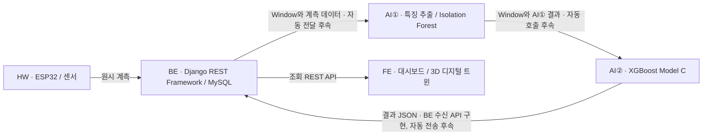
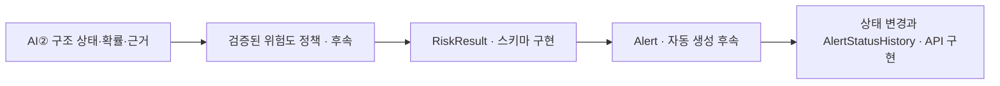

# INFRIUM 프로젝트 개발 문서

INFRIUM은 교량 모형에서 얻은 센서 계측값을 AI로 분석하고, 분석 결과와 원본 데이터를 연결해 웹 대시보드와 3D 디지털 트윈에 표시하는 구조 상태 모니터링 프로토타입이다. 교량 모형과 통제된 실험 환경에서 IoT·AI·백엔드·시각화 간 데이터 흐름을 검증한다. 실제 교량의 안전 등급 산정과 운영 의사결정은 검증 범위 밖이다.

문서의 **코드 확인** 표시는 BE 저장소 기준이다. HW·AI·FE의 입력과 출력은 첨부 요구사항에서 정의한 설계이며, 별도 파트 소스와 실제 실행 결과는 이번 확인 범위에 포함되지 않았다. 백엔드 모델, API, 연동 계약은 [백엔드 개발 명세](BACKEND.md)에 정리했다.

## 배경과 해결하려는 문제

교량은 반복 하중과 진동, 환경 변화, 노후화에 따라 구조 상태가 변한다. 현장 정기점검은 인력과 시간이 필요하고, 점검 사이의 변화나 짧은 이상 신호를 연속적으로 포착하기 어렵다. 계측량이 많아지면 사람이 원본 신호를 일일이 해석하기도 어렵다. 계측값, 분석 결과, 점검 이력이 분리되어 있으면 특정 결과가 어느 센서와 실험 조건에서 나왔는지 재구성하기 어렵다.

INFRIUM은 시간순으로 계측값을 수집하고, 이상 탐지와 구조 상태 분류를 분리한다. 원본 계측값을 분석 Window와 연결해 분석의 출처를 추적하고, 부재와 센서의 위치를 3D 모델에 연결해 사용자가 어느 지점의 결과를 보는지 파악할 수 있게 한다. 활용 범위는 교량 모형 실험, 센서 기반 구조 건전성 관찰, 이상 탐지 검증, 디지털 트윈 시각화다.

## 구성과 인터페이스

| 파트 | 입력 | 처리 | 출력과 연동 상태 |
| --- | --- | --- | --- |
| HW | 교량 모형의 진동, 하중과 실험 조건 | ESP32와 가속도 센서 계측, 센서 식별, 시간과 순번 부여 | `event_id`, `sensor_id`, `measured_at`, 3축 가속도 등. BE 배치 형식은 구현되어 있으며 실제 장치의 실시간 송신 검증은 후속 |
| AI① | 센서별 시계열 및 Window 범위 | 전처리, 진동 특징 추출, Isolation Forest 기반 이상 탐지 | `anomaly_score`, `anomaly_label`, `model_version`과 AI② 입력. BE에 저장 모델과 CRUD가 있으며 자동 분석 서비스 연동은 후속 |
| AI② | AI① 결과 및 Window·실험·교량 식별 정보 | XGBoost Model C로 구조 상태 분류, 품질과 판단 근거 구성 | `damage_class`, 확률, `data_quality`, `evidence`, 처리 상태. Django 수신 계약은 코드 확인. 모델 실행과 자동 호출·전송 검증은 후속 |
| BE | 원시 계측 배치, AI② 결과 JSON, 사용자 API 요청 | 식별자와 계약 검증, 트랜잭션 저장, 결과 조회, 사용자 토큰 및 알림 상태 관리 | MySQL 레코드와 REST 응답. 자동 Window 생성·분석 호출·위험도 산정은 후속 |
| FE | 센서, 측정값, AI 결과, 알림 및 사용자 API 응답 | 로그인, 시계열과 상태 표시, 알림 읽음·처리, 3D 센서 위치 표시 | 사용자용 대시보드와 디지털 트윈 설계. FE 실행·표시 검증은 별도 저장소 필요 |

AI①의 이상 점수는 센서 신호의 이상 징후를, AI②의 `NORMAL / D1 / D2 / D3`는 실험 구조 상태를 표현한다. BE의 실험 조건 코드에서 D1은 연결부 풀림, D2는 지지조건 변경, D3는 부재 강성 변경이다. 이 코드와 AI② 라벨의 의미가 동일하게 유지되는지는 모델·실험 데이터 통합 시 확인한다. `risk_score`와 `risk_level`은 검증된 별도 정책을 적용할 때까지 `null`을 유지한다.

## 데이터 라이프사이클

1. 실험 시작 전에 교량, 구조 부재, 센서 및 실험 메타데이터를 등록한다. 센서의 3D 좌표는 모델에서의 위치 표시를 지원한다. 좌표 원점, 단위, 축 방향은 FE와 HW가 통합 시 합의한다.
2. 계측 송신 측은 측정별 `event_id`를 구성하고 교량별 배열로 보낸다. Django는 교량과 실험 소속, 센서 활성 여부, 이벤트 고유성을 확인한 뒤 `Measurement`로 저장한다. 한 배치의 저장은 원자적으로 처리된다.
3. 분석 작업은 시간 구간과 포함된 계측을 `AnalysisWindow`로 연결한다. 현재 Window와 Measurement 간 연결은 모델과 API로 지원하며, 배치 수신이 Window를 자동 생성하는 흐름은 후속이다.
4. AI①은 Window의 신호에서 특징을 추출하고 센서별 이상 결과를 만든다. `AnomalyResult`는 Window·센서·모델 버전으로 결과를 추적한다. Window의 `ai1_payload`와 `ai2_request_payload`는 파트 간 JSON을 보존할 수 있다.
5. AI②는 구조 상태·확률·품질·근거를 결과 JSON으로 제공한다. BE는 `ai2-risk-evidence-v1`을 검증하고, 일치하는 Window가 있으면 연결한다. Window가 없더라도 원본과 결과를 보존한다.
6. 대시보드는 BE의 계측·센서·AI② 조회 API를 사용한다. 센서별 그래프는 교량과 시간 구간으로 범위를 좁히고, 디지털 트윈은 센서의 `model_x/y/z`와 부재 정보를 사용한다. Window에 연결되지 않은 분석은 교량별 조회에서 빠지므로 FE 연동에서 별도 처리 기준이 필요하다.

### 검증된 위험도 정책 적용 이후

위험 정책은 구조 상태와 품질·이상 신호·실험 조건을 검토해 점수와 등급을 산출하는 별도 규칙이다. 정책 확정 후에도 사용자 읽음과 현장 조치 상태는 별도로 기록한다.

## 구현 현황과 후속 우선순위

| 범위 | 현재 상태 | 완료 판단 기준 |
| --- | --- | --- |
| BE 기반 | 모델, MySQL 설정, 마이그레이션, CRUD 코드 확인 | 개발 DB에서 마이그레이션 및 기본 CRUD 실행 확인 |
| 계측 수신·조회 | Batch, 중복 검증, 원자적 저장, 시간 필터 코드 확인 | 실제 장치 입력과 재전송을 포함한 재현 가능한 검증 |
| 사용자·알림 | 토큰 인증, 알림 목록·요약·읽음·상태 이력 코드 확인 | 사용자 흐름 및 API 권한 검증 |
| AI② 수신·조회 | 계약 검증, Window 선택 연결, 원본 보존, 순차 재전송 처리 및 조회 필터 코드 확인 | 실제 AI② 결과로 정상·오류·동시 재시도 검증 |
| HW → AI① → AI② → BE → FE | 자동 통합 후속 | 교량 모형에서 생성된 동일 이벤트의 계측·분석·화면 표시를 식별자로 추적 |
| 위험도와 자동 알림 | 데이터 모델과 수동 관리 API 구현, 산정·자동 생성 후속 | 실험 기반 검증 기준 합의 후 정책과 알림 생성 규칙 검증 |
| 고주파 데이터 | 복합 인덱스와 기간 필터 구현, 확장 작업 후속 | 부하 측정 기반 배치 크기, 페이지네이션, 다운샘플링 및 보관 정책 확정 |

전체 구현률은 파트별 합의된 검증 항목과 실행 결과가 확보되면 산정한다. 현재 확인 가능한 수준은 BE 수신·저장·조회 경로의 핵심 코드 구현과 전체 자동 통합의 후속 상태다.

1. **통합 계약 확정** — 공통 식별자 범위, 시간대, 샘플 단위와 Window 생성 책임을 확정하고 대표 JSON과 실패 사례를 고정한다. 외부 연동 전 사용자·장치·AI 서비스 권한을 적용한다.
2. **계측에서 화면까지 연결** — ESP32 실측 배치, Window 생성, AI①과 AI② 호출, AI② 재시도, FE 표시를 순차적으로 연결한다. 실험별로 데이터 누락과 역순 도착을 확인한다.
3. **RiskScore·RiskLevel 검증** — 실험 조건별 분류 성능, 오탐·미탐, 데이터 결손과 예열 상태를 평가하고 점수·등급 경계와 정책 버전을 확정한다.
4. **자동 Alert** — 검증 결과를 기반으로 생성 기준과 반복 발생 억제, 해결·재발 규칙을 구현한다. 이력에는 정책 버전과 처리 주체를 추적할 수 있게 한다.
5. **고주파 최적화** — 초당 계측량과 조회 지연을 측정하고 배치 제한, 페이지네이션, 표시용 다운샘플링, 장기 보관 기준을 적용한다.

**프로젝트 한 줄 요약** — INFRIUM은 교량 모형의 계측과 AI 분석을 추적 가능한 데이터로 연결해 대시보드와 3D 모델에서 관찰하는 구조 상태 모니터링 프로토타입이다.
